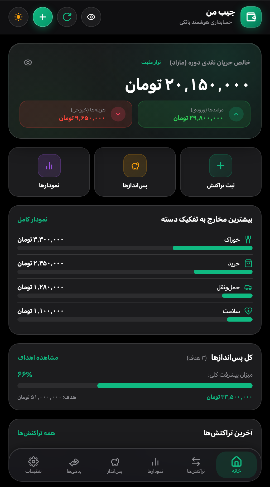
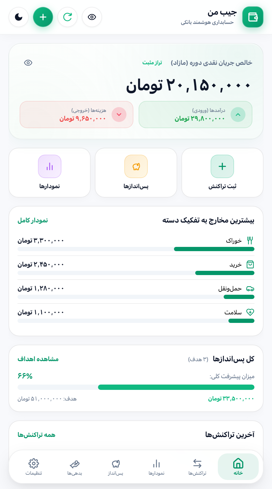
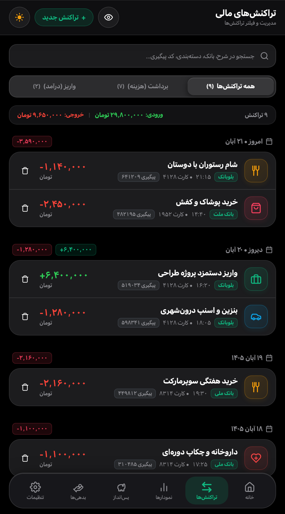
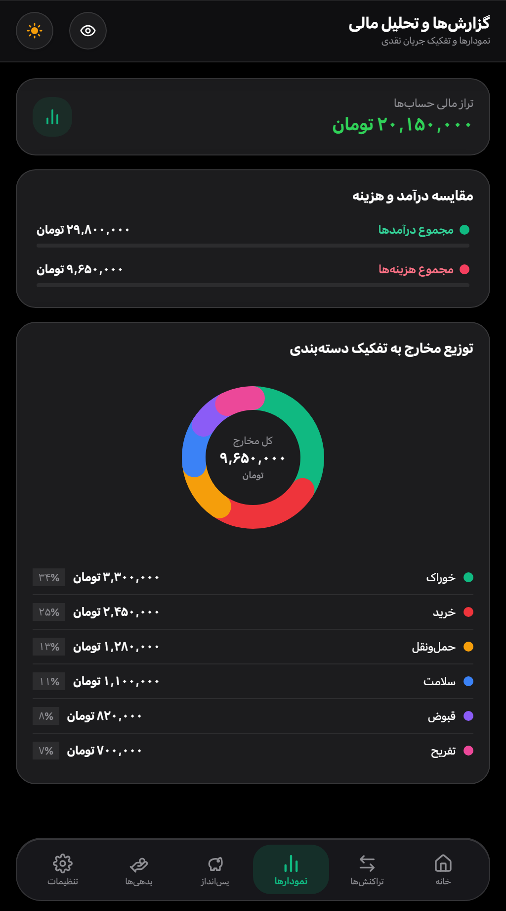
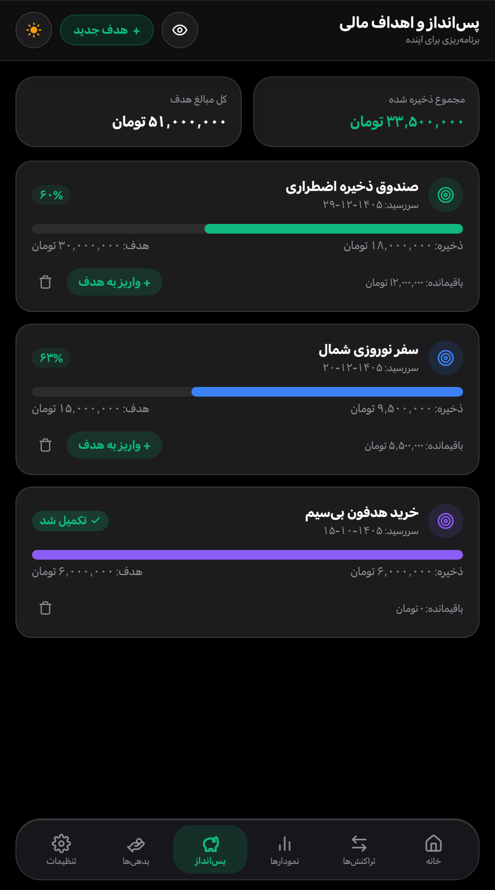
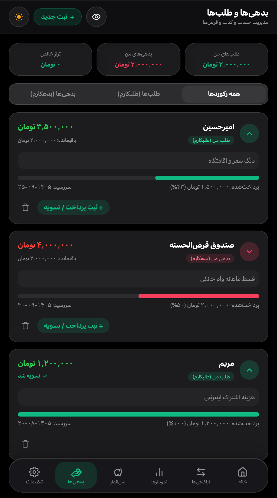
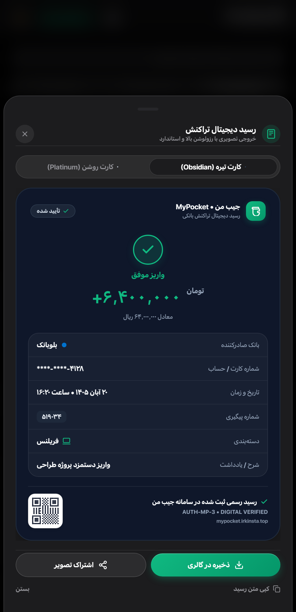
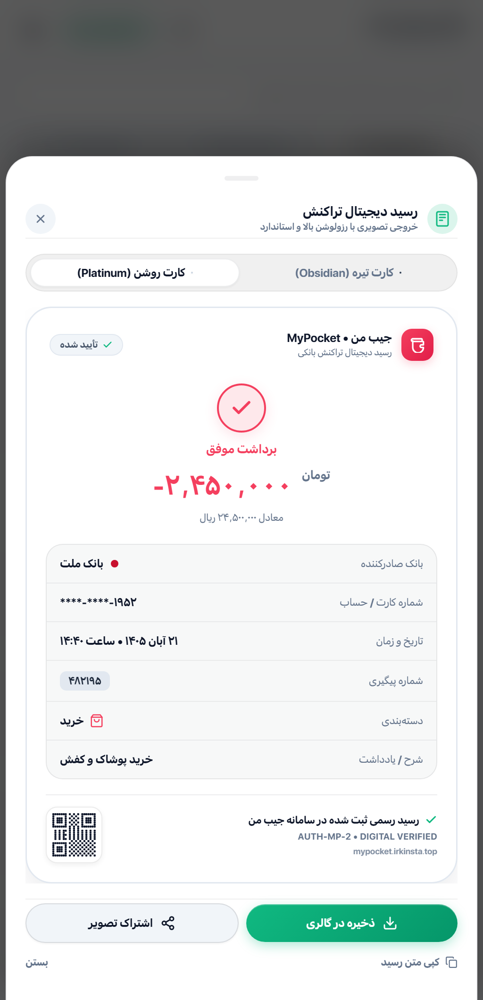

# جیب من (MyPocket)

**یک حسابدار شخصی و ساده در جیب شما — بدون نیاز به وارد کردن دستی تک‌تک خرج‌ها**

> **توجه:** این صفحه صرفاً برای **معرفی برنامه «جیب من»** و نمایش تصاویر محیط داخلی آن ساخته شده است و شامل فایل نصب یا کد برنامه نیست.

---

## جیب من چیست و به چه درد می‌خورد؟

بسیاری از ما وسط روز خریدهای کوچک و بزرگ انجام می‌دهیم، کارت می‌کشیم یا کارت‌به‌کارت می‌کنیم و آخر ماه نمی‌دانیم پولمان دقیقاً کجا خرج شده است. نوشتن همه‌ی خرج‌ها در دفتر یا برنامه‌های حسابداری هم معمولاً بعد از چند روز فراموش می‌شود.

**«جیب من»** این کار را خودکار می‌کند:

- کافی است برنامه را روی گوشی اندرویدی خود داشته باشید؛ هر زمان پیامکی از بانک‌های ایرانی (مثل ملت، ملی، بلوبانک، پاسارگاد، سامان، کشاورزی و ده‌ها بانک و نئوبانک دیگر) برایتان بیاید، برنامه مبلغ آن را به **تومان** می‌خواند، نوعش را (واریز یا برداشت) تشخیص می‌دهد و در دسته‌بندی مناسب ثبت می‌کند.
- پیامک‌های **رمز دوم (رمز پویا)**، کد تأیید و پیام‌های تبلیغاتی نادیده گرفته می‌شوند تا حساب‌وکتاب شما به‌هم نریزد.
- اگر خرید نقدی انجام دادید، می‌توانید در چند ثانیه به‌صورت دستی هم آن را ثبت کنید.

---

## امکانات اصلی برای استفاده روزمره

- **داشبورد یک‌نگاه:** در صفحه اول خیلی سریع می‌بینید چقدر پول وارد حسابتان شده، چقدر خرج کرده‌اید و در نهایت چقدر برایتان باقی مانده است.
- **حریم خصوصی روی گوشی خودتان:** همه‌ی پیامک‌ها روی **خود گوشی شما** بررسی می‌شوند و به هیچ سرور بیرونی فرستاده نمی‌شوند. با یک لمس آیکون «چشم» می‌توانید همه‌ی مبالغ را در جمع یا هنگام اسکرین‌شات مخفی کنید، و با قفل اثر انگشت از برنامه محافظت کنید.
- **دسته‌بندی و نمودارهای واضح:** می‌فهمید دقیقاً چند درصد پولتان صرف خوراک، خرید، رفت‌وآمد، قبوض، سلامت یا تفریح شده است.
- **قلک پس‌انداز و هدف‌گذاری:** برای اهدافتان (مثل صندوق ذخیره اضطراری، سفر یا خرید وسیله) قلک بسازید و ببینید چند درصد به هدف نزدیک شده‌اید.
- **دفتر بدهی و طلب:** فراموش نکنید چقدر به چه کسی بدهکارید یا از چه کسی طلب دارید؛ حتی اگر قسطی و در چند نوبت تسویه شود.
- **رسید تصویری مرتب برای اشتراک‌گذاری:** از هر تراکنش در دو قالب **تیره** و **روشن** یک رسید زیبا بسازید (با مخفی ماندن رقم‌های وسط کارت) و در گالری ذخیره یا برای دیگران ارسال کنید.
- **ظاهر مطابق سلیقه شما:** پشتیبانی کامل از حالت تاریک و روشن، و امکان نمایش عددها به شکل فارسی یا انگلیسی.

---

## تصاویری از محیط برنامه

### ۱. صفحه اصلی (داشبورد) — در حالت تاریک و روشن

| حالت تاریک | حالت روشن |
| :---: | :---: |
|  |  |

### ۲. فهرست تراکنش‌ها و نمودار گزارش‌های مالی

| تاریخچه و جستجوی تراکنش‌ها | نمودار مقایسه و دسته‌بندی مخارج |
| :---: | :---: |
|  |  |

### ۳. قلک پس‌انداز و مدیریت بدهی‌ها و طلب‌ها

| اهداف پس‌انداز و پیشرفت | دفتر حساب‌وکتاب بدهی و طلب |
| :---: | :---: |
|  |  |

### ۴. رسید تصویری قابل ذخیره و اشتراک‌گذاری

| رسید با قالب تیره | رسید با قالب روشن |
| :---: | :---: |
|  |  |

